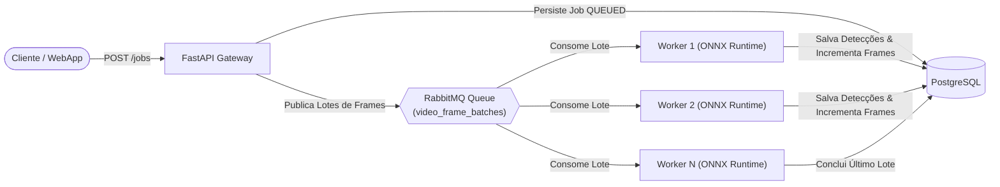

# Pipeline Distribuído para Processamento de Vídeo em Lote

<div align="center">


<p>Sistema distribuído de alta escalabilidade para particionamento de vídeo em lotes, orquestração assíncrona com <b>RabbitMQ</b> e inferência de visão computacional paralela via <b>YOLOv8 / ONNX Runtime</b>.</p>

</div>

---

## 🏗️ Arquitetura & Fluxo de Mensageria



---

## 🏛️ Clean Architecture: Estrutura em Camadas

### 1. Ordem de Escrita (de dentro pra fora)

| Ordem | Camada | Arquivo(s) | Por quê essa ordem |
|---|---|---|---|
| 1 | Domínio / Enums & Entidades | `backend/app/core/domain/enum/job_status.py`<br/>`backend/app/core/domain/models/video_job.py` | Modela o ciclo de vida do job, caixas delimitadoras e mensagens de lote sem dependência externa. |
| 2 | Domínio / Portas & Gateways | `backend/app/core/domain/gateway/message_broker_gateway.py`<br/>`backend/app/core/domain/gateway/inference_gateway.py`<br/>`backend/app/core/domain/gateway/job_repository_gateway.py` | Contratos abstratos para fila de mensagens, motor de inferência e persistência de dados. |
| 3 | Aplicação / Casos de Uso | `backend/app/core/usecase/create_batch_job_usecase.py`<br/>`backend/app/core/usecase/process_frame_batch_worker_usecase.py`<br/>`backend/app/core/usecase/get_job_status_usecase.py` | Orquestra a partição de lotes e o ciclo de processamento do worker via portas de domínio. |
| 4 | Infraestrutura / Adaptadores | `backend/app/infrastructure/gateway/rabbitmq_broker_impl.py`<br/>`backend/app/infrastructure/gateway/onnx_yolo_inference_impl.py`<br/>`backend/app/infrastructure/gateway/postgres_job_repository_impl.py` | Implementações reais conectando RabbitMQ (AMQP), sessões ONNX Runtime e PostgreSQL. |
| 5 | Apresentação / API REST & Worker Daemon | `backend/app/presentation/dtos/video_job_dto.py`<br/>`backend/app/presentation/api/v1/controllers/video_job_controller.py`<br/>`backend/main.py`<br/>`backend/worker.py` | Endpoints HTTP assíncronos e processo daemon independente para consumo de fila. |
| 6 | Frontend / Angular 17+ Standalone | `frontend/src/app/domain/models/video-job.model.ts`<br/>`frontend/src/app/infrastructure/api/video-pipeline-api.service.ts`<br/>`frontend/src/app/presentation/pages/dashboard/dashboard.component.ts` | Interface executiva para submissão de vídeos, acompanhamento de progresso e visualização de detecções. |

### 2. Ordem de Leitura (de fora pra dentro)

| Ordem | Pergunta que você está respondendo | Arquivo(s) |
|---|---|---|
| 1 | Quais endpoints de submissão e consulta existem? | `backend/app/presentation/api/v1/router.py` |
| 2 | Como as requisições são recebidas e validadas? | `backend/app/presentation/api/v1/controllers/video_job_controller.py` |
| 3 | O que o gateway faz ao receber um vídeo? | `backend/app/core/usecase/create_batch_job_usecase.py` |
| 4 | O que o worker faz ao puxar uma mensagem da fila? | `backend/app/core/usecase/process_frame_batch_worker_usecase.py` |
| 5 | Quais contratos regem a fila e o modelo de visão? | `backend/app/core/domain/gateway/*` |
| 6 | Como a inferência YOLOv8 e o broker são implementados? | `backend/app/infrastructure/gateway/*` |

---

## 🐳 Execução via Docker Compose

```bash
# Iniciar API, Worker, RabbitMQ, PostgreSQL e Frontend
docker compose up --build -d

# Visualizar logs do worker em tempo real
docker compose logs -f worker
```

### Portas e Serviços:
- **Frontend Angular 17+:** [http://localhost:4200](http://localhost:4200)
- **FastAPI Video Gateway:** [http://localhost:8000](http://localhost:8000)
- **Documentação OpenAPI Swagger:** [http://localhost:8000/docs](http://localhost:8000/docs)
- **Painel RabbitMQ Management:** [http://localhost:15672](http://localhost:15672) (usuário: `guest` / senha: `guest`)
- **PostgreSQL Database:** `localhost:5432`

---

## 🧪 Executando Testes Unitários

```bash
cd backend
python -m venv .venv
source .venv/bin/activate
pip install -r requirements.txt
pytest tests/ -v
```

---

## 📄 Licença

Distribuído sob a licença MIT. Consulte `LICENSE` para mais detalhes.
